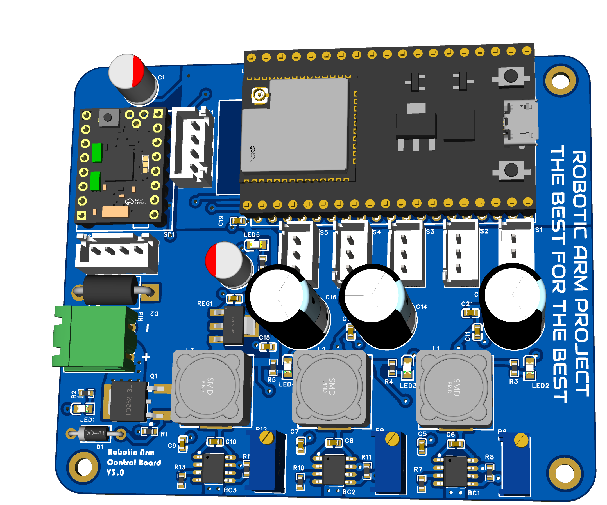

# Robotic Arm Control PCB

I designed the complete board in EasyEDA Pro. ESP32 control board with five servo outputs, three adjustable buck rails, a TMC2209 stepper driver, and an I2C distance sensor port. Built and worked.

